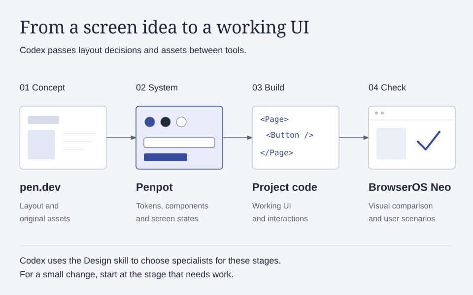
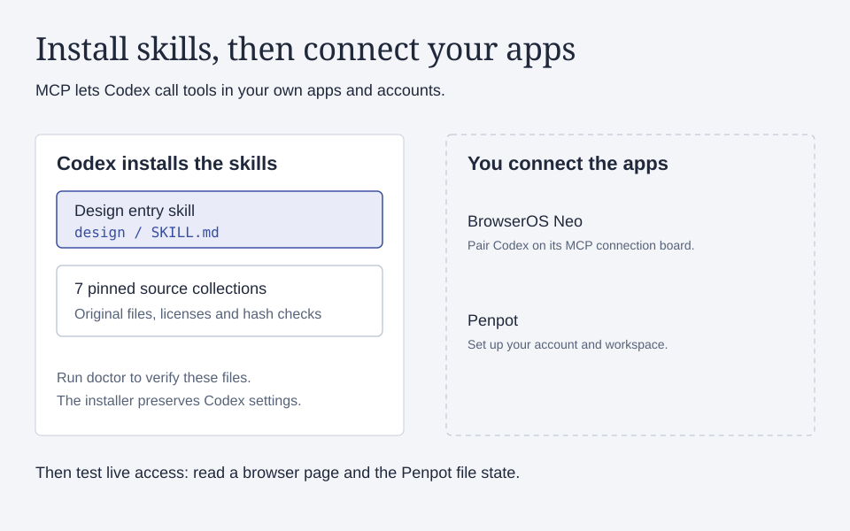
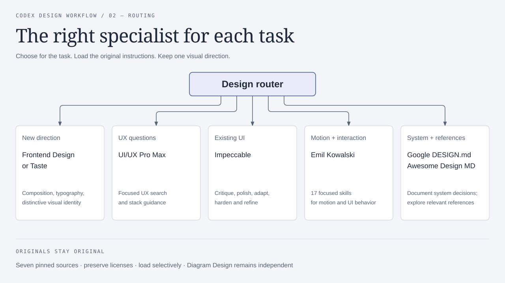

# Codex Design Workflow

A set of Codex skills for designing and building interfaces with pen.dev and
Penpot. Use it to take a new screen from concept to code, or to improve an existing
interface while keeping its visual style.

A skill is a folder of instructions that Codex reads for a particular task. This
package adds a `design` skill that tells Codex which specialist to use and what to
carry from one stage to the next: source assets, tokens, components and interaction
rules. It downloads original skills and reference material from seven repositories.



## A task you could give it

> Use $design to build a pricing page for our product. Keep our existing typography
> and colors, include monthly and annual billing, and check the result on mobile.

With the apps connected, Codex starts from the product and the current design.
For a new direction it reads
Frontend Design or Taste, develops a concept in pen.dev, and defines reusable
parts in Penpot. It then implements the page in your project's stack and checks
layout and billing interactions in BrowserOS Neo. For a small change to an existing
page, it starts at the stage that needs work.

You keep control of the brief and the approved direction. The Design instructions
ask Codex to reuse those decisions during implementation and to check motion as
part of the interface. Connect the apps below before asking Codex to use them.

## Install with Codex

Copy [the installation prompt](prompts/INSTALL.md), or paste this into Codex:

> Set up https://github.com/Lenfer/codex-design-workflow using its prompts/INSTALL.md.
> Read the task and plan first, inspect the installer, then install the Design
> workflow and all pinned sources. Configure my own BrowserOS Neo connection and
> verify it. I will install pen.dev and Penpot myself. Preserve my existing skills
> and Codex settings, and report any remaining manual setup.

You need Codex, Python 3.9+ and Git. The installer uses Python's standard library.
It has been tested on macOS. The implementation also targets Linux; separate Linux,
Windows and WSL validation is pending.

To run the installation yourself:

```bash
git clone https://github.com/Lenfer/codex-design-workflow.git
cd codex-design-workflow
python3 -B install.py plan --target /absolute/path/to/your-project
python3 -B install.py install --target /absolute/path/to/your-project
python3 -B install.py doctor --target /absolute/path/to/your-project
```

Use `--target` for a project or `--user` for your personal installation across
projects. Start with project scope if you want to try the workflow first.

The installer writes the entry skill and the upstream library to separate locations:

```text
<target>/.agents/skills/design/        # discoverable router and helpers
<target>/.design-workflow/library/     # pinned, unmodified upstream files
```

Codex discovers `design` and reads the relevant originals from the library as it
works. The installer checks exact commits and content hashes, preserves licenses
and reports a conflict if a different Design skill already exists. Repeating the
installation reuses verified files. It preserves your Codex configuration and
`AGENTS.md`.

Keep the downloaded library and the local path setting out of your project's Git history:

```gitignore
.design-workflow/
.agents/skills/design/installation.json
```

Restart Codex if it has not discovered the new skill. See the
[official Codex skills documentation](https://developers.openai.com/codex/skills).

## Connect the apps



| App | Setup |
| --- | --- |
| BrowserOS Neo | The install prompt guides Codex through the official install. You complete local account setup and pair Codex from Neo's MCP connection board. |
| pen.dev | Install the app yourself, then connect its supported agent integration. |
| Penpot | Set up your instance or hosted account, then connect the intended workspace. |

MCP is the connection through which Codex uses an app's tools. Each recipient uses
their own connection and signs into their own accounts. Follow
[setup and live verification](docs/SETUP.md) for the app instructions and checks.

`doctor` verifies installed files. Test each MCP connection with a read-only tool
call before relying on it. The package does not include optional Node/ffmpeg
runtimes, Swift/Expo, the Impeccable engine or the Google DESIGN.md npm CLI.

## Choose skills by task



| Source | Use it for | License |
| --- | --- | --- |
| [Frontend Design](https://github.com/anthropics/skills/tree/main/skills/frontend-design) | Establish a visual direction and compose the interface. | Apache-2.0 |
| [Taste](https://github.com/Leonxlnx/taste-skill) | Design a corporate or product website when its layout rules fit the brief. | MIT |
| [UI/UX Pro Max](https://github.com/nextlevelbuilder/ui-ux-pro-max-skill) | Search for UX and stack guidance on a specific question. | MIT |
| [Impeccable](https://github.com/pbakaus/impeccable) | Review and refine existing UI, including responsive behavior and edge states. | Apache-2.0 |
| [Emil Kowalski's skills](https://github.com/emilkowalski/skills) | Motion, interactions and native/mobile UI, including Swift. The collection includes 17 skills. | MIT |
| [Google DESIGN.md](https://github.com/google-labs-code/design.md) | Record the design system's values and rationale in a documented format. | Apache-2.0 |
| [Awesome Design MD](https://github.com/VoltAgent/awesome-design-md) | Browse design-system references. | MIT |

Codex uses one lead skill for a stage and adds specialists for specific tasks.
Google DESIGN.md and Awesome Design MD are reference resources. Impeccable runs
as instructions and playbooks in this bundle; its engine and detector are not
installed. Diagram Design is a separate skill outside this workflow.

Read the [full routing](skills/design/references/routing.md),
[stage handoffs](skills/design/references/stages.md) and
[compatibility notes](skills/design/references/compatibility.md) for the details.
The [source lock file](skills/design/sources.lock.json) records exact versions;
[attribution](THIRD_PARTY.md) lists the original licenses.

## Models

| Task | Suggested model and reasoning |
| --- | --- |
| Brief, concept, design system and complex checks | GPT-6.1 Sol, high |
| Routine implementation | GPT-6.1 Sol, medium |
| Icons and complex pen.dev animation | GPT-6 Astra, medium |

The workflow owner chose Astra Medium for icons and complex pen.dev animation.
The Sol placements are recommendations. Use models available in your environment;
the installer leaves your model settings intact. Read the
[model recommendations](skills/design/references/models.md) for the scope of these choices.

## Check and maintain the installation

For the first three commands, replace `/path/to/installed/design` with the installed
Design skill directory. You can run those helpers from any working directory.
The final `unittest` command tests this package: run it from the root of this
repository checkout, where `tests/` is located.

```bash
python3 -B /path/to/installed/design/scripts/library.py status
python3 -B /path/to/installed/design/scripts/library.py resolve emil
python3 -B /path/to/installed/design/scripts/library.py check-updates
python3 -B -m unittest discover -s tests -v
```

`status` and `resolve` verify installed content. `check-updates` compares upstream
HEAD without replacing files. Review the source and license changes, update the
lock file, and test a fresh target before adopting another version. Keep the
selected version fixed while working on a design stage.

To replace a personal installation, back up the existing router and library and
resolve any reported conflicts. For offline installation, pass
`--source-cache /path/to/releases` with the same `<id>/<commit>` layout; hash checks
still apply. A retry reuses complete, verified releases. After an interrupted
process, check that no installer is running before removing its stale lock.
Preserve modified or incomplete trees if the installer reports a mismatch.

To uninstall, check for local edits, then remove this package's router and library.
The installer makes no Codex configuration changes to undo.

See the [task](docs/TASK.md), [implementation plan](docs/IMPLEMENTATION_PLAN.md),
[validation results](docs/VALIDATION.md) and [diagram sources](docs/figures/README.md).
First-party code and documentation use the [MIT License](LICENSE).
